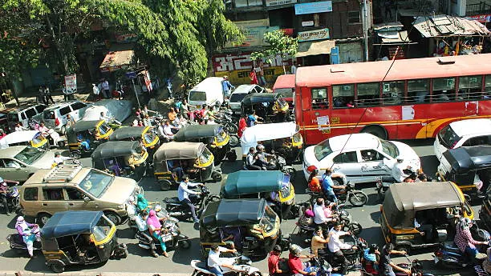
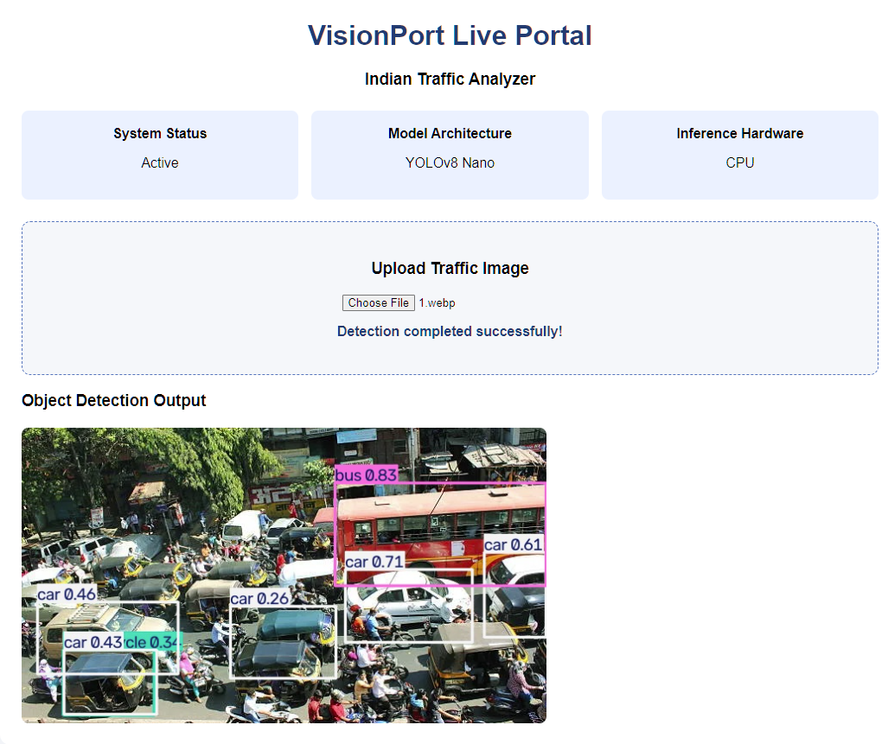
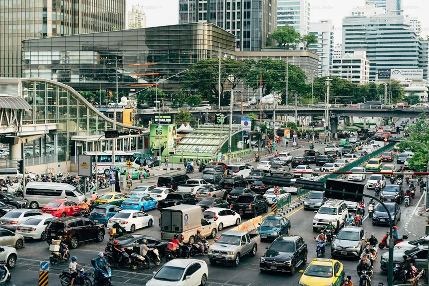
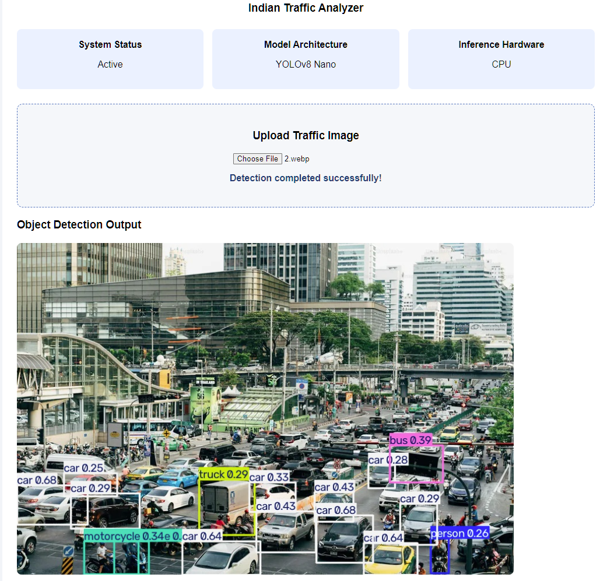
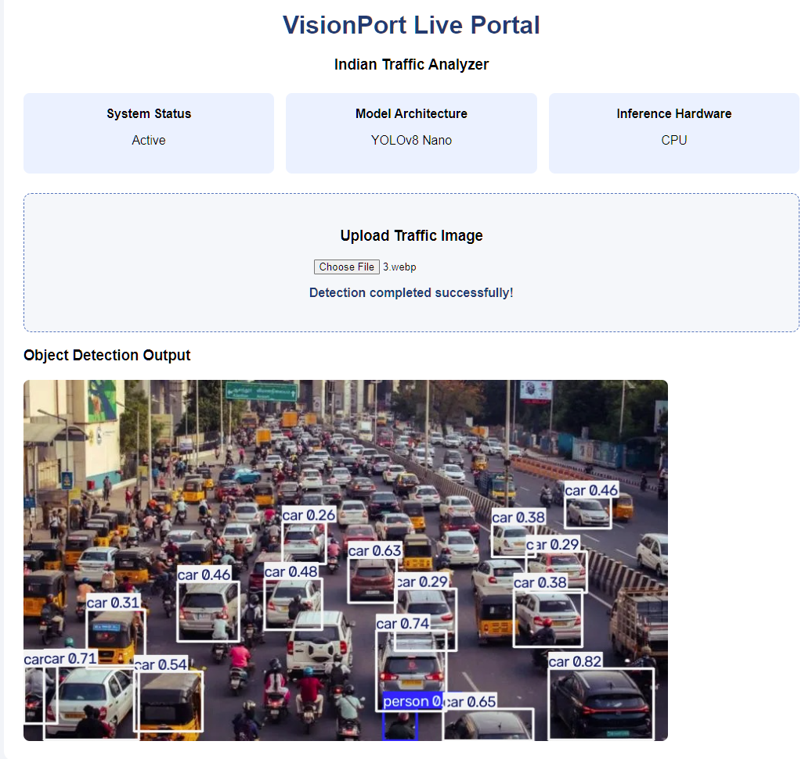

# VisionPort – Indian Traffic Analyzer (M1 Skill)

## 1. Skill Exercises

### 1.1 Baseline Run (`imgsz=416`, `conf=0.25`, CPU)
- **Image 1 (`Traffic_Images/1.webp`)**: Detected `bus` (0.83), `car` (0.26–0.71), `motorcycle` (0.34).
- **Image 2 (`Traffic_Images/2.webp`)**: Detected `car` (0.25–0.68), `truck` (0.29), `bus` (0.39), `motorcycle` (0.34), `person` (0.26).
- **Image 3 (`Traffic_Images/3.webp`)**: Detected `car` (0.26–0.82), `person`.

### 1.2 Input Images & Detection Outputs

| Image | Input (`Traffic_Images/`) | Output (`Outputs/`) |
| :---: | :---: | :---: |
| **Image 1** |  |  |
| **Image 2** |  |  |
| **Image 3** |  |  |

### 1.3 Effect of Changing Confidence Threshold (`conf=0.25` → `0.50`, `imgsz=416`)
- Raising `conf` from `0.25` to `0.50` filters out low-confidence detections.
- Fewer bounding boxes are returned (e.g., Image 2 dropped from `{'bus': 3, 'person': 1}` to `{'bus': 1}`; Image 3 dropped from `{'bus': 4, 'car': 3, 'motorcycle': 1, 'person': 1}` to `{'bus': 1, 'car': 1}`).
- **Trade-off**: Higher precision (fewer false positives) at the cost of lower recall (more missed objects, especially smaller or occluded vehicles).

### 1.4 Effect of Changing Input Image Size (`imgsz=416` → `320`, `conf=0.25`)
- Reducing `imgsz` from `416` to `320` significantly speeds up CPU inference:
  - Image 1: `95.5 ms` → `43.3 ms`
  - Image 2: `82.8 ms` → `43.9 ms`
  - Image 3: `44.2 ms` → `22.7 ms`
- **Trade-off**: Faster inference, but lower spatial resolution makes small/distant objects harder to detect accurately.

### 1.5 Why Inference Time Varies Across Computers
- **CPU architecture & clock speed**: Newer CPUs with higher single/multi-core performance and wider SIMD/AVX instructions execute tensor operations faster.
- **RAM speed & thermal throttling**: Memory bandwidth and laptop power/thermal limits affect sustained CPU throughput.
- **Background load**: Other running applications compete for CPU cores and cache.
- **Software/runtime**: Different Python, PyTorch, or OpenCV/ONNX versions and thread settings.

---

## 2. Observation Table

*(Measured on CPU with `yolov8n.pt`, `imgsz=416`, `conf=0.25`)*

| Image No. | Objects Detected | Preprocess (ms) | Inference (ms) | Postprocess (ms) | Remarks |
| :--- | :--- | :---: | :---: | :---: | :--- |
| 1 | `bus`, `car`, `motorcycle` (and `truck` on re-run) | 2.38 | 95.47 | 2.16 | Dense Indian traffic; buses and cars detected clearly. |
| 2 | `car`, `truck`, `bus`, `motorcycle`, `person` | 2.98 | 82.79 | 1.39 | Multiple overlapping vehicles; lower-confidence detections appear near `0.25`. |
| 3 | `car`, `person` (plus `bus`, `motorcycle` on re-run) | 2.17 | 44.20 | 1.31 | Fastest inference among the three; clear car detections up to `0.82`. |

---

## 3. Viva-Voce Questions & Answers

1. **What is object detection?**
   A computer vision task that identifies *what* objects are in an image (classification) and *where* they are located using bounding boxes (localization).
2. **What does YOLO stand for?**
   **You Only Look Once** — a single-stage real-time object detection architecture that predicts bounding boxes and class probabilities in a single forward pass.
3. **What is the difference between image classification and object detection?**
   Image classification assigns a single label (or set of labels) to the entire image, whereas object detection locates multiple objects in the image with bounding boxes and assigns a class label + confidence score to each.
4. **What is the role of FastAPI in this application?**
   FastAPI serves as the Python web backend that exposes HTTP endpoints (`/`, `/health`, `/detect/`), receives uploaded images, runs YOLOv8 Nano inference, and returns the annotated JPEG image.
5. **What is an API endpoint? Identify the endpoint used in this skill.**
   An API endpoint is a specific URL path where a backend service listens for requests. The detection endpoint used here is `POST http://127.0.0.1:8000/detect/`.
6. **Why is `FormData` used when uploading an image?**
   `FormData` packages binary files (like images) into `multipart/form-data` format so JavaScript `fetch()` can send the file to FastAPI's `UploadFile` parameter.
7. **What is the purpose of the pretrained file `yolov8n.pt`?**
   It contains the pretrained weights of the YOLOv8 Nano model (trained on the COCO dataset), allowing the app to perform inference immediately without training from scratch.
8. **What is inference?**
   Running a trained/pretrained model on new, unseen input data to generate predictions (without updating model weights).
9. **What is the purpose of preprocessing and postprocessing?**
   - **Preprocessing**: Decodes image bytes, resizes/pads the image to `imgsz`, and normalizes pixel values for the model.
   - **Postprocessing**: Applies confidence thresholding (`conf`) and Non-Maximum Suppression (NMS) to filter overlapping boxes, then draws labels and boxes on the output image.
10. **What does HTTP status code `200` mean?**
    `200 OK` means the server successfully processed the HTTP request and returned a valid response.
11. **Why is CORS required when the frontend and backend use different ports?**
    Browsers enforce the Same-Origin Policy, blocking requests from `http://127.0.0.1:5500` (Live Server) to `http://127.0.0.1:8000` (FastAPI) unless the backend explicitly allows that origin via CORS headers.
12. **What is the difference between CPU and GPU execution?**
    CPUs are optimized for sequential/general-purpose tasks with fewer cores, while GPUs have thousands of parallel cores optimized for matrix/tensor operations, making deep learning inference much faster on GPUs.
13. **Does this skill use Triton or TensorRT? Explain.**
    No. This introductory skill runs PyTorch/Ultralytics directly on the CPU via FastAPI. NVIDIA Triton Inference Server and TensorRT are advanced deployment/optimization tools for high-throughput production serving.
14. **What is a bounding box and what is a confidence score?**
    A **bounding box** is the rectangular coordinate region enclosing a detected object. A **confidence score** (0 to 1) indicates how certain the model is that the box contains an object of that predicted class.

